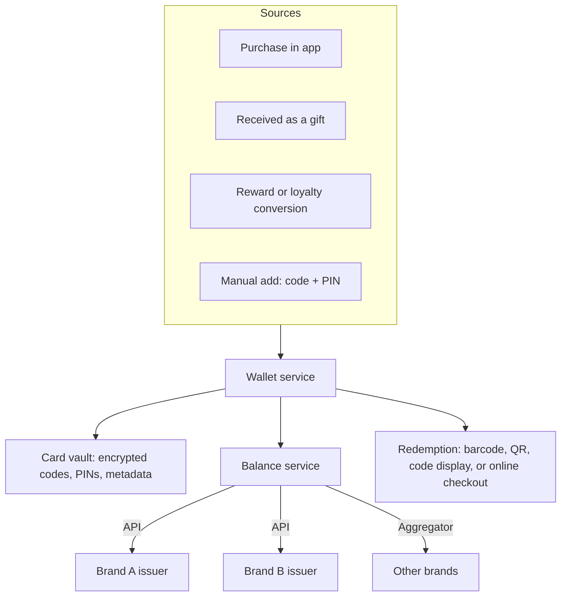

# Multi-Brand Gift Card Wallet

An educational guide to the **multi-brand gift card wallet**: a single app or account where a customer stores, views, and redeems digital gift cards from many brands. Covers how it fits into a gift card system, the data model behind it, and the design choices around security, balances, and redemption. Written for product teams and platform buyers looking at solutions in the [EVD System](https://evdsystem.com/) and [MoboGage](https://evdsystem.com/about-mobogage/) family.

---

## What Is a Multi-Brand Gift Card Wallet?

A **multi-brand gift card wallet** is a customer-facing container that holds digital gift cards and vouchers from different brands in one place. Instead of digging through emails and SMS messages for codes, the customer opens one wallet, sees each card with its brand, balance, and expiry, and redeems it in-store or online.

It is different from a stored-value e-wallet. The wallet does not usually hold money of its own; it holds **references to gift cards** whose value lives in each brand's (or the issuer's) gift card system. Some providers combine the two, but keeping the concepts separate avoids confusion about who owes the customer what.

### Where you see them

- Telecom and super-apps that sell gift cards alongside airtime and bills
- Bank and loyalty apps offering gift cards as rewards
- Corporate gifting and employee reward portals
- Retailer or mall programmes covering several stores

---

## How It Works

### Core components

| Component | Responsibility |
|-----------|----------------|
| **Card vault** | Stores codes and PINs encrypted; reveals them only on authenticated request |
| **Brand catalogue** | Logos, redemption instructions, terms, and supported channels per brand |
| **Balance service** | Fetches live balances from issuers or aggregators, with caching |
| **Redemption display** | Shows barcode, QR, or code in the right format for each brand's POS |
| **Gifting and transfer** | Sends a card to another user and removes it from the sender |
| **Notifications** | Expiry reminders, low balance, received-gift alerts |
| **Issuer connectors** | Integrations with brand gift card systems or a catalogue aggregator |

See [docs/glossary.md](./docs/glossary.md) for terminology.

---

## Practical Design Choices

| Question | Option A | Option B | Notes |
|----------|----------|----------|-------|
| Balance freshness | Live check on open | Cached, refresh on demand | Live checks cost API calls; show "last updated" when cached |
| Code reveal | Always visible | Tap and authenticate to reveal | Hidden-by-default reduces shoulder-surfing and screenshot leaks |
| Manually added cards | Allowed | Only cards bought in-app | Manual cards add value for users but cannot always be balance-checked |
| Gift transfer | Re-issue new code | Move existing code | Re-issue is safer when the issuer supports it |
| Partial use | Track remaining balance | Treat as single-use | Depends on each brand's rules |

---

## Design Considerations

- **Respect each brand's rules.** Some cards are single-use, some allow partial redemption, some work online only. The catalogue must hold this per brand.
- **Security of codes.** A gift card code is bearer value. Encrypt at rest, mask by default, rate-limit reveals, and log every reveal.
- **Clear ownership.** Once a card is gifted, the sender should no longer be able to see the code.
- **Expiry visibility.** Reminders before expiry are one of the most valued wallet features and reduce complaints.
- **Graceful issuer outages.** If one brand's balance API is down, show the cached value with a note rather than an error for the whole wallet.
- **Accessibility at checkout.** Bright screen, large barcode, and offline display of the last-known code help at busy tills.

MoboGage's EVD System supports gift cards and loyalty vouchers alongside telecom airtime, with voucher generation, inventory, and lifecycle handled in one voucher management system.

---

## FAQ

**What is a multi-brand gift card wallet?**
An app or account that stores digital gift cards from many brands in one place, showing balances and expiry and letting the customer redeem them.

**Is a gift card wallet the same as a digital wallet?**
Not necessarily. A digital wallet usually holds stored value. A gift card wallet holds references to gift cards whose value is held by each issuing brand.

**Can a gift card wallet check balances for every brand?**
Only where the brand or an aggregator offers a balance API. Cards without one can still be stored, but balance tracking may be manual.

**How should gift card codes be protected in a wallet?**
Encrypt them at rest, hide them until the user authenticates, limit how often they can be revealed, and log access.

**How does this relate to MoboGage / EVD System?**
MoboGage's EVD System manages electronic vouchers, including gift cards and loyalty vouchers. See the [voucher management system](https://evdsystem.com/voucher-management-system-mobogage/) and [about MoboGage](https://evdsystem.com/about-mobogage/).

---

## Further Reading / Related Industry Resources

- [Voucher management system by MoboGage](https://evdsystem.com/voucher-management-system-mobogage/) — managing gift card and voucher inventory and lifecycle
- [What is an electronic voucher?](https://evdsystem.com/evd-software/what-is-an-electronic-voucher/) — the basics of e-vouchers and codes
- Related repo: [gift-card-system-architecture](https://github.com/iwtglobal/gift-card-system-architecture) — the components of a gift card system

---

## License

Documentation in this repository is provided under the MIT License. See [LICENSE](./LICENSE).

*Educational material only. Not legal, regulatory, or financial advice. MoboGage and EVD System refer to offerings on evdsystem.com.*
